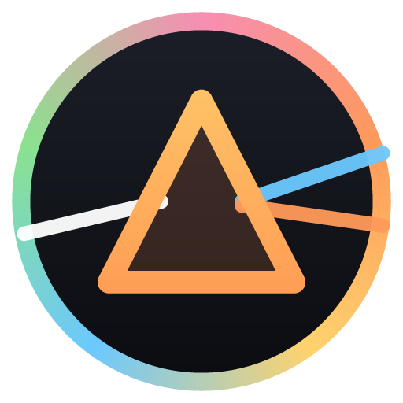
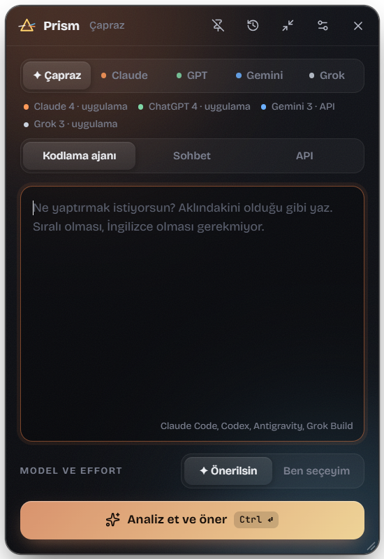
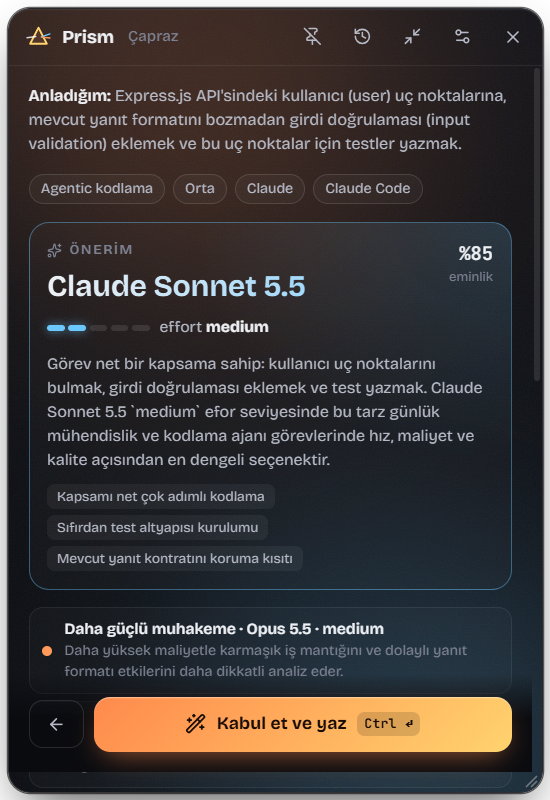
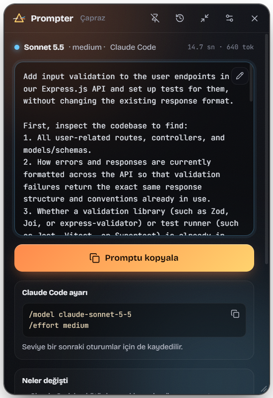

<div align="center">



# Prism

**Write a rough prompt. Get one tuned for the exact model you'll use.**

A desktop widget that rewrites your prompt for **Claude, GPT, Gemini or Grok**: it picks the right model and
effort level, asks a couple of clarifying questions when needed, and writes a copy-ready prompt for your coding
agent, chat app or API call. Bring your own API key; nothing runs on someone else's server.

[](https://github.com/ugurshelby/prism/actions/workflows/ci.yml)
[](https://github.com/ugurshelby/prism/releases/latest)
[](#install)
[](LICENSE)

**[Website and downloads](https://ugurshelby.github.io/prism/)** · **English** · [Türkçe](README.tr.md)





</div>

## Features

- **Four model families, one place.** Claude (Fable, Opus, Sonnet, Haiku), OpenAI (GPT-6 Astra, GPT-6.1 Sol/Terra,
  GPT-6 Luna), Gemini (4 Argon, 3.8 Flash, 3.5 Flash-Lite) and Grok (4.7, 4.3, Build). Rules come from each vendor's
  official prompting guide, distilled into editable [knowledge cards](knowledge/).
- **Model and effort recommendation.** Prism reads your task and suggests the model and level (Claude `effort`,
  OpenAI/Grok `reasoning effort`, Gemini `thinking level`) with its reasoning and a confidence score. Choose
  "✦ Cross" to compare across every family you have access to.
- **Written for where you'll paste it.** Coding agents (Claude Code, Codex, Antigravity, Grok Build), chat apps
  or the API. The result also tells you how to set that model and level in the target tool.
- **Your keys, verified.** Add a key for Vertex AI, Google AI Studio, Anthropic, OpenAI or xAI. Prism checks it
  right away and lists the models it can reach.
- **Stays out of the way.** Always-on-top panel, global hotkey, collapsible orb, tray menu, a notification when a
  prompt is ready, optional start at login, and a searchable history.
- **Private by design.** Keys and history are encrypted with your OS secure storage. No telemetry, no Prism server;
  prompts go only to the provider you chose (see [Security and privacy](#security-and-privacy) for what that provider keeps).

> The interface is in Turkish today; generated prompts are written in English. Translations are welcome.

## Versions

Each major version of Prism has a name, following the path of light through a prism.

| Version | Name | What it does | Status |
|---|---|---|---|
| 1.x | **Ray** | A single beam: prompts for Claude only, one engine (Vertex AI); installs next to Spectrum | Legacy: still downloadable, no security fixes |
| 2.x | **Spectrum** | Splits the beam: Claude, GPT, Gemini and Grok, your own keys, cross-family recommendation | **Current** |
| 3.x | **Lens** | Focuses several models on one task: multi-model workflows | Planned |
| 4.x | **Iris** | Beyond text: image, video, audio and 3D generation models | Planned |

Prism was called *Prompter* until 2.0. Installing Prism over Prompter keeps your settings, keys and history.

## Install

Download the installer for your system from the **[website](https://ugurshelby.github.io/prism/download/)** or the
**[latest release](https://github.com/ugurshelby/prism/releases/latest)**:

| System | File |
|---|---|
| Windows 10/11 (x64) | `Prism-Setup-<version>-x64.exe` |
| macOS, Apple Silicon (M1 and later) | `Prism-<version>-mac-arm64.dmg` |
| macOS, Intel | `Prism-<version>-mac-x64.dmg` |
| Linux (x64) | `Prism-<version>-linux-x86_64.AppImage` or `Prism-<version>-linux-amd64.deb` |

The builds are open source but not signed with a paid developer certificate, so the first launch needs one extra step:

- **Windows:** SmartScreen shows "Windows protected your PC" → **More info → Run anyway**.
- **macOS:** open the `.dmg`, drag Prism to Applications, open it once, then go to
  **System Settings → Privacy & Security → Open Anyway**. (Alternative: `xattr -dr com.apple.quarantine /Applications/Prism.app`.)
- **Linux AppImage:** `chmod +x Prism-*.AppImage && ./Prism-*.AppImage`.
  **Debian/Ubuntu:** `sudo apt install ./Prism-*-linux-amd64.deb`.
  Key storage needs a keyring (GNOME Keyring or KWallet), which most desktops already have.

Each release includes `SHA256SUMS.txt`. Download it next to the installer and check before running:

- **Windows (PowerShell):** `Get-FileHash .\Prism-Setup-<version>-x64.exe -Algorithm SHA256` and compare with the line in `SHA256SUMS.txt`.
- **macOS:** `shasum -a 256 -c SHA256SUMS.txt --ignore-missing`
- **Linux:** `sha256sum -c SHA256SUMS.txt --ignore-missing`

Prism has no auto-updater and never downloads code by itself. To update, download the new installer and install it
over the old one; your settings, keys and history are kept.

### Build from source

Requirements: [Node.js 22+](https://nodejs.org) and Git.

```bash
git clone https://github.com/ugurshelby/prism.git
cd prism
npm ci
npm run setup     # checks Node, downloads Electron if needed, creates .env from .env.example
npm run dev
```

To build an installer yourself: `npm run dist:win`, `npm run dist:mac` or `npm run dist:linux` (output in `release/`).

## Quick start

1. **Add a key.** On first launch Prism shows a setup screen. Paste an API key from any provider below and press
   **Kaydet** (Save). It is verified immediately; the green status means the engine is ready. Use the **Key al**
   link next to each provider to open its key page.
2. **Mark the apps you use.** In the same screen, tick the ecosystems you use through a subscription app
   (for example Claude Code or ChatGPT) so cross-family recommendations include them.
3. **Write, review, copy.** Type your rough prompt, press `Ctrl+Enter`, check the recommendation, answer any
   questions, and copy the final prompt.

## Providers and API keys

Prism uses one model as its **engine** (it analyzes and writes) and writes for a **target** model (the one you
paste the prompt into). The engine runs on whichever provider you add a key for; one key is enough.

| Provider | Get a key | Engine models | Unlocks targets |
|---|---|---|---|
| Google AI Studio | [aistudio.google.com/apikey](https://aistudio.google.com/apikey) | Gemini | Gemini |
| Vertex AI | [Google Cloud Console → Credentials](https://console.cloud.google.com/apis/credentials) | Gemini | Gemini |
| Anthropic | [platform.claude.com/settings/keys](https://platform.claude.com/settings/keys) | Claude | Claude |
| OpenAI | [platform.openai.com/api-keys](https://platform.openai.com/api-keys) | GPT | GPT |
| xAI | [console.x.ai](https://console.x.ai) | Grok | Grok |

- **Verification:** saving a key sends a lightweight request to the provider and lists the text models that key can
  use. Invalid keys are rejected with a clear message. **Doğrula ve modelleri getir** (Verify) repeats the check.
- **Engine choice:** Settings → *Prism motoru*. "Auto" prefers a verified provider (Vertex AI first). If you pick a
  provider and its key is missing or unreadable, Prism stops with an error instead of switching to another provider. Analysis and writing models can be set separately; **Motoru test et** sends a short test request.
- **Vertex AI** also needs your Google Cloud project ID (Settings, or `VERTEX_PROJECT_ID` in `.env`) with the Vertex AI API
  enabled. Keep the location `global`, since some models (such as `gemini-4-argon`) are not served from regional endpoints.
- **Keys are read only from encrypted storage** in the installed app. Environment variables and `.env` files are plain
  text, so only the development build (`npm run dev`, `npm run selftest`) reads them (see [`.env.example`](.env.example)).
  If an older version left a `.env` with keys in the user data folder, Settings tells you to save the key there
  and then delete the file.

## How it works

```
your rough prompt ──► engine (your key) ──► analysis: task, best model + level, questions
                                       └──► rewrite with the target family's knowledge cards ──► copy
```

- **Ecosystem:** pick Claude, GPT, Gemini or Grok to stay within one family, or **✦ Cross** to let the analysis choose
  among the models you can use (verified keys plus apps you marked).
- **Surface:** *Kodlama ajanı* (coding agent), *Sohbet* (chat) or *API*. The prompt's structure and the setup tips
  change accordingly.
- **"Önerilsin / Ben seçeyim":** take the recommendation, or choose the model and level yourself; only the levels the
  model supports are shown.

## Everyday use

- `Ctrl+Shift+Space` (`Cmd+Shift+Space` on macOS) shows or hides the panel; change it in Settings.
- Closing the window keeps Prism in the tray (menu bar on macOS). The tray menu opens history, settings and shows
  the active engine.
- The pin keeps the panel on top; the collapse button turns it into a small draggable orb.
- History keeps your last 200 prompts on this computer, encrypted, tagged with family, model, level and engine; search
  and filter by family, copy again or rewrite. Turn it off in Settings → *Gizlilik* (Privacy).

## Security and privacy

- **Keys** are encrypted with the OS secure storage (Windows DPAPI, macOS Keychain, Linux Secret Service/KWallet) and
  stored only in your user data folder. They are never written to logs or error messages; the interface sees only
  the last four characters so you can tell keys apart. Linux without a keyring: Prism refuses to save keys rather
  than storing them weakly.
- **History** is encrypted the same way. Older plain-text history files are moved into encrypted storage on first
  launch, then overwritten and deleted. Without a keyring, history stays in memory for the session only. You can turn
  history off, and you can hide the window from screenshots and screen sharing (macOS, and Windows 10 2004 or later); both are in
  Settings → *Gizlilik*.
- **Prompts go only to the engine provider you chose**, over HTTPS, and only to that provider's API hosts. What the
  provider keeps depends on its terms, not on Prism:
  - **Google AI Studio, free tier:** Google may use prompts and responses to improve its products, and human reviewers
    may read them ([terms](https://aistudio.google.com/docs/terms)). Don't send confidential material with a free
    key; use a billed project or Vertex AI.
  - **OpenAI and xAI:** requests are sent with `store: false`, so responses are not kept as application state.
    Providers may still keep data for abuse monitoring (OpenAI: up to 30 days,
    [details](https://developers.openai.com/api/docs/guides/your-data)).
  - **Anthropic, Vertex AI and paid Gemini API:** see each provider's data usage terms.
- No telemetry, no crash reports, no Prism server, no auto-updater.
- **Hardening:** sandboxed renderer, strict CSP, blocked navigation and permissions, every request from the interface
  validated, and Electron fuses in packaged builds. CI runs lint, type checks, tests, a dependency audit and a Semgrep
  scan. Actions are pinned, and the repository uses secret scanning with push protection, Dependabot and CodeQL.
- **Local threat model:** OS secure storage protects your data from other user accounts and from copies of the files.
  It does not protect against malware running under your own account (on Windows, DPAPI decrypts for any program in
  your session). See [SECURITY.md](SECURITY.md#scope).

See [SECURITY.md](SECURITY.md) for details and how to report a vulnerability privately.

## Troubleshooting

| Symptom | Fix |
|---|---|
| `401` / "key rejected" | Wrong key or the API isn't enabled for it. Re-enter the key in Settings and press Verify. |
| Vertex `404` | Location must be `global`; check the project ID and that the Vertex AI API is enabled. |
| `429` | Rate limit or quota. Prism retries twice, then shows the error. |
| Engine "yapılandırılmamış" (not configured) | Add at least one key; Vertex also needs a project ID. |
| Linux: "Sistem anahtarlığı bulunamadı" | Install and unlock GNOME Keyring or KWallet, then restart Prism. Without a keyring, keys cannot be saved. |
| "key'i .env dosyasında" | An older version read keys from `.env`. Save the key in Settings → Sağlayıcılar, then delete the `.env` file. |
| `npm run dev` can't find Electron | Run `npm run setup`. |

## Development

| Command | What it does |
|---|---|
| `npm run dev` | Run with hot reload |
| `npm run mock` | Open the interface in a browser with fake data (`#setup` shows the first-run screen) |
| `npm run typecheck` / `npm run build` | Type-check / build into `out/` |
| `npm run lint` / `npm test` | oxlint (type-aware, security rules) / unit tests (Vitest) |
| `npm run selftest -- "prompt"` | One real analyze → write round trip without the UI (`--family`, `--surface`, `--engine`) |
| `npm run selftest -- --discover` | Verify configured keys and list reachable models |
| `npx electron . --selftest --smoke` | Offline check that the app boots and loads every knowledge card |
| `npm run dist:win` / `dist:mac` / `dist:linux` | Build installers into `release/` |

Use `PRISM_USER_DATA=./tmp-userdata npm run dev` to keep your real settings and history untouched.

Prompt quality lives in [`knowledge/`](knowledge/): per family `principles.md`, `effort.md`, `models.md`, one card
per surface and one per target model. Cards are re-read on every request. See [CONTRIBUTING.md](CONTRIBUTING.md).

Built with Electron, React and TypeScript.

## License

[MIT](LICENSE). Model names are trademarks of their respective owners; Prism is not affiliated with Anthropic,
Google, OpenAI or xAI.
