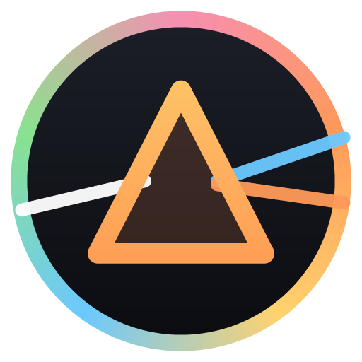
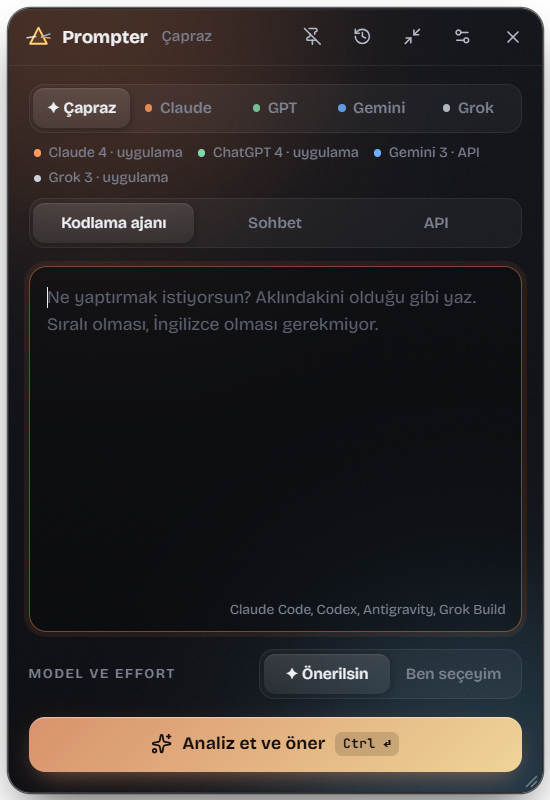
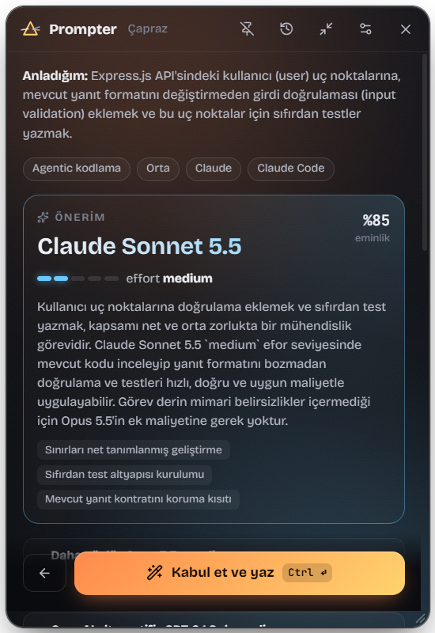
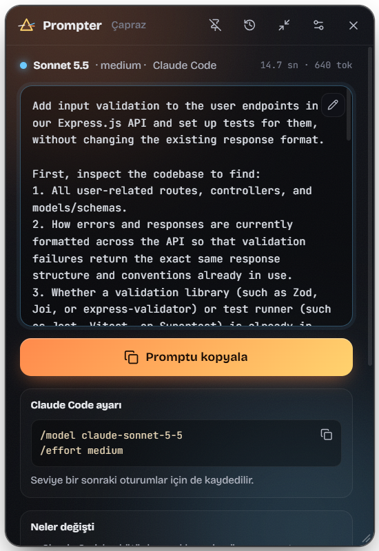

<div align="center">



# Prompter

**Ham promptunu yaz, kullanacağın modele göre yeniden yazılmış hâlini al.**

Promptunu **Claude, GPT, Gemini ya da Grok** için yeniden yazan bir masaüstü widget'ı. Doğru modeli ve seviyeyi
önerir, gerekirse birkaç netleştirme sorusu sorar ve kodlama ajanına, sohbet uygulamasına ya da API çağrına
yapıştırmaya hazır promptu yazar. Kendi API key'inle çalışır; araya başka bir sunucu girmez.

[](https://github.com/ugurshelby/prompter/actions/workflows/ci.yml)
[](https://github.com/ugurshelby/prompter/releases/latest)
[](#kurulum)
[](LICENSE)

[English](README.md) · **Türkçe**





</div>

## Özellikler

- **Dört model ailesi tek yerde.** Claude (Fable, Opus, Sonnet, Haiku), OpenAI (GPT-6 Astra, GPT-6.1 Sol/Terra,
  GPT-6 Luna), Gemini (4 Argon, 3.8 Flash, 3.5 Flash-Lite) ve Grok (4.7, 4.3, Build). Kurallar her üreticinin resmî
  prompt rehberinden damıtılıp düzenlenebilir [bilgi kartlarına](knowledge/) yazıldı.
- **Model ve seviye önerisi.** Prompter görevi okuyup model ve seviyeyi (Claude `effort`, OpenAI/Grok
  `reasoning effort`, Gemini `thinking level`) gerekçesi ve eminlik oranıyla önerir. "✦ Çapraz" seçilirse
  erişebildiğin tüm aileler arasından seçer.
- **Yapıştıracağın yere göre yazılır.** Kodlama ajanları (Claude Code, Codex, Antigravity, Grok Build), sohbet
  uygulamaları ya da API. Sonuç ekranı modeli ve seviyeyi hedef araçta nasıl ayarlayacağını da söyler.
- **Key'lerin anında doğrulanır.** Vertex AI, Google AI Studio, Anthropic, OpenAI ya da xAI key'i ekle; Prompter
  hemen dener ve erişebildiği modelleri listeler.
- **Yoluna çıkmaz.** Her zaman üstte duran panel, genel kısayol, küçülünce sürüklenebilir küre, tray menüsü, prompt
  hazır olunca bildirim, oturum açılışında başlatma ve aranabilir geçmiş.
- **Gizlilik baştan düşünüldü.** Key'ler işletim sisteminin şifrelemesiyle saklanır ve ana süreçten çıkmaz.
  Telemetri yok, sunucu yok.

> Arayüz şimdilik Türkçe; yazılan promptlar İngilizce. Çeviri katkılarına açığız.

## Kurulum

Sistemine uygun kurulum dosyasını **[son sürümden](https://github.com/ugurshelby/prompter/releases/latest)** indir:

| Sistem | Dosya |
|---|---|
| Windows 10/11 (x64) | `Prompter-Setup-<sürüm>-x64.exe` |
| macOS, Apple Silicon (M1 ve sonrası) | `Prompter-<sürüm>-mac-arm64.dmg` |
| macOS, Intel | `Prompter-<sürüm>-mac-x64.dmg` |
| Linux (x64) | `Prompter-<sürüm>-linux-x86_64.AppImage` ya da `Prompter-<sürüm>-linux-amd64.deb` |

Kurulum dosyaları açık kaynak ama ücretli bir geliştirici sertifikasıyla imzalı değil; bu yüzden ilk açılışta bir
kez onay gerekir:

- **Windows:** SmartScreen "Windows bilgisayarınızı korudu" der → **Ek bilgi → Yine de çalıştır**.
- **macOS:** `.dmg`'yi aç, Prompter'ı Uygulamalar'a sürükle, bir kez açmayı dene, sonra
  **Sistem Ayarları → Gizlilik ve Güvenlik → Yine de Aç**. (Alternatif: `xattr -dr com.apple.quarantine /Applications/Prompter.app`.)
- **Linux AppImage:** `chmod +x Prompter-*.AppImage && ./Prompter-*.AppImage`.
  **Debian/Ubuntu:** `sudo apt install ./Prompter-*-linux-amd64.deb`.
  Key saklamak için bir anahtarlık (GNOME Keyring ya da KWallet) gerekir; çoğu masaüstünde zaten vardır.

Her sürümde indirdiğin dosyayı doğrulaman için `SHA256SUMS.txt` bulunur. Yeni sürümü eskisinin üzerine kurmak
ayarlarını, key'lerini ve geçmişini korur.

### Kaynaktan çalıştırma

Gereksinimler: [Node.js 22+](https://nodejs.org) ve Git.

```bash
git clone https://github.com/ugurshelby/prompter.git
cd prompter
npm ci
npm run setup     # Node'u denetler, gerekirse Electron'u indirir, .env.example'dan .env oluşturur
npm run dev
```

Kendi kurulum dosyanı üretmek için: `npm run dist:win`, `npm run dist:mac` ya da `npm run dist:linux` (çıktı `release/`).

## Hızlı başlangıç

1. **Key ekle.** İlk açılışta kurulum ekranı gelir. Aşağıdaki sağlayıcılardan birinin key'ini yapıştırıp
   **Kaydet**'e bas; anında doğrulanır, yeşil durum motorun hazır olduğunu gösterir. Her sağlayıcının yanındaki
   **Key al** bağlantısı key sayfasını açar.
2. **Kullandığın uygulamaları işaretle.** Aynı ekranda abonelikle kullandığın ekosistemleri (ör. Claude Code,
   ChatGPT) işaretle; çapraz öneri bunları da hesaba katar.
3. **Yaz, gözden geçir, kopyala.** Ham promptunu yaz, `Ctrl+Enter`'a bas, öneriyi kontrol et, varsa soruları
   yanıtla ve son promptu kopyala.

## Sağlayıcılar ve API key'leri

Prompter bir modeli **motor** olarak kullanır (analiz eder ve yazar) ve bir **hedef** model için yazar (promptu
yapıştıracağın model). Motor, key'ini eklediğin sağlayıcıda çalışır; tek key yeterli.

| Sağlayıcı | Key nereden | Motor modelleri | Açtığı hedefler |
|---|---|---|---|
| Google AI Studio | [aistudio.google.com/apikey](https://aistudio.google.com/apikey) | Gemini | Gemini |
| Vertex AI | [Google Cloud Console → Credentials](https://console.cloud.google.com/apis/credentials) | Gemini | Gemini |
| Anthropic | [platform.claude.com/settings/keys](https://platform.claude.com/settings/keys) | Claude | Claude |
| OpenAI | [platform.openai.com/api-keys](https://platform.openai.com/api-keys) | GPT | GPT |
| xAI | [console.x.ai](https://console.x.ai) | Grok | Grok |

- **Doğrulama:** Key kaydedilince sağlayıcıya hafif bir istek gider ve o key'in kullanabildiği metin modelleri
  listelenir. Geçersiz key anlaşılır bir mesajla reddedilir. **Doğrula ve modelleri getir** kontrolü tekrarlar.
- **Motor seçimi:** Ayarlar → *Prompter motoru*. "Otomatik", Vertex AI tanımlıysa onu, değilse doğrulanmış ilk
  sağlayıcıyı kullanır. Analiz ve yazım modelleri ayrı seçilebilir; **Motoru test et** kısa bir deneme isteği gönderir.
- **Vertex AI** için Google Cloud proje ID'si de gerekir (Ayarlar ya da `VERTEX_PROJECT_ID`) ve projede Vertex AI
  API'si etkin olmalı. Konum `global` kalmalı; bazı modeller (ör. `gemini-4-argon`) bölgesel uç noktalarda yok.
- **Arayüzsüz:** Key'ler ortam değişkeninden ya da `.env` dosyasından da okunur ([`.env.example`](.env.example)).
  Sıra: Ayarlar'da kayıtlı key → ortam değişkeni → `.env`. Kurulu uygulama `.env`'i kullanıcı klasöründe arar:
  `%APPDATA%\Prompter` (Windows), `~/Library/Application Support/Prompter` (macOS), `~/.config/Prompter` (Linux).

## Nasıl çalışır

```
ham prompt ──► motor (senin key'in) ──► analiz: görev, en uygun model + seviye, sorular
                                   └──► hedef ailenin bilgi kartlarıyla yeniden yazım ──► kopyala
```

- **Ekosistem:** Tek ailede kalmak için Claude, GPT, Gemini ya da Grok; erişebildiğin modeller (doğrulanmış key'ler
  ve işaretlediğin uygulamalar) arasından seçtirmek için **✦ Çapraz**.
- **Yüzey:** Kodlama ajanı, sohbet ya da API. Promptun yapısı ve kurulum ipuçları buna göre değişir.
- **Önerilsin / Ben seçeyim:** Öneriyi al ya da modeli ve seviyeyi kendin seç; yalnızca modelin desteklediği
  seviyeler gösterilir.

## Günlük kullanım

- `Ctrl+Shift+Space` (macOS'ta `Cmd+Shift+Space`) paneli gösterir ya da gizler; Ayarlar'dan değişir.
- Pencereyi kapatmak Prompter'ı tray'e (macOS'ta menü çubuğuna) gizler. Tray menüsü geçmişi ve ayarları açar, aktif
  motoru gösterir.
- Raptiye paneli her zaman üstte tutar; küçült düğmesi onu sürüklenebilir küçük bir küreye çevirir.
- Geçmiş son 200 promptu bu bilgisayarda aile, model, seviye ve motorla etiketli tutar; aileye göre süz, ara, tekrar
  kopyala ya da yeniden yaz.

## Güvenlik ve gizlilik

- Key'ler işletim sisteminin güvenli deposuyla (Windows DPAPI, macOS Keychain, Linux Secret Service/KWallet)
  şifrelenip yalnızca kullanıcı klasöründe saklanır; arayüze gönderilmez, loglara yazılmaz. Anahtarlığı olmayan
  Linux'ta Prompter key'i zayıf korumayla saklamak yerine kaydetmeyi reddeder.
- Promptlar yalnızca seçtiğin motor sağlayıcısına HTTPS ile gider. OpenAI ve xAI istekleri `store: false` ile
  gönderilir. Telemetri ya da başka bir sunucu yok.
- Uygulama sertleştirildi: izole (sandbox) arayüz, sıkı CSP, engellenmiş sayfa geçişi ve izinler, paketlenmiş
  sürümde Electron fuse'ları. CI'daki action'lar sabitlendi; depoda push korumalı gizli bilgi taraması, Dependabot ve
  CodeQL açık.

Ayrıntılar ve güvenlik açığını gizlice bildirme yolu: [SECURITY.md](SECURITY.md).

## Sorun giderme

| Belirti | Çözüm |
|---|---|
| `401` / "key reddedildi" | Key yanlış ya da ilgili API etkin değil. Ayarlar'dan key'i yeniden gir ve Doğrula'ya bas. |
| Vertex `404` | Konum `global` olmalı; proje ID'sini ve Vertex AI API'sinin etkin olduğunu kontrol et. |
| `429` | Hız sınırı ya da kota. Prompter iki kez dener, sonra hatayı gösterir. |
| Motor "yapılandırılmamış" | En az bir key ekle; Vertex için proje ID'si de gerekir. |
| Linux: "Sistem anahtarlığı bulunamadı" | GNOME Keyring ya da KWallet kur/aç, ya da key'i `~/.config/Prompter/.env` dosyasına yaz. |
| `npm run dev` Electron'u bulamıyor | `npm run setup` çalıştır. |

## Geliştirme

| Komut | Ne yapar |
|---|---|
| `npm run dev` | Sıcak yenilemeyle çalıştırır |
| `npm run mock` | Arayüzü sahte verilerle tarayıcıda açar (`#setup` ilk kurulum ekranı) |
| `npm run typecheck` / `npm run build` | Tip kontrolü / `out/` klasörüne derleme |
| `npm run selftest -- "prompt"` | Arayüzsüz gerçek bir analiz → yazım turu (`--family`, `--surface`, `--engine`) |
| `npm run selftest -- --discover` | Tanımlı key'leri doğrular, erişilen modelleri listeler |
| `npx electron . --selftest --smoke` | Ağsız kontrol: uygulama açılıyor ve tüm bilgi kartlarını yüklüyor mu |
| `npm run dist:win` / `dist:mac` / `dist:linux` | `release/` klasörüne kurulum dosyası üretir |

Gerçek ayar ve geçmişine dokunmadan denemek için: `PROMPTER_USER_DATA=./tmp-userdata npm run dev`.

Prompt kalitesi [`knowledge/`](knowledge/) klasöründe: her aile için `principles.md`, `effort.md`, `models.md`, her
yüzey ve her hedef model için birer kart. Kartlar her istekte yeniden okunur. Bkz. [CONTRIBUTING.md](CONTRIBUTING.md).

Electron, React ve TypeScript ile yapıldı.

## Lisans

[MIT](LICENSE). Model adları sahiplerinin ticari markalarıdır; Prompter'ın Anthropic, Google, OpenAI ya da xAI ile
bir bağı yoktur.
